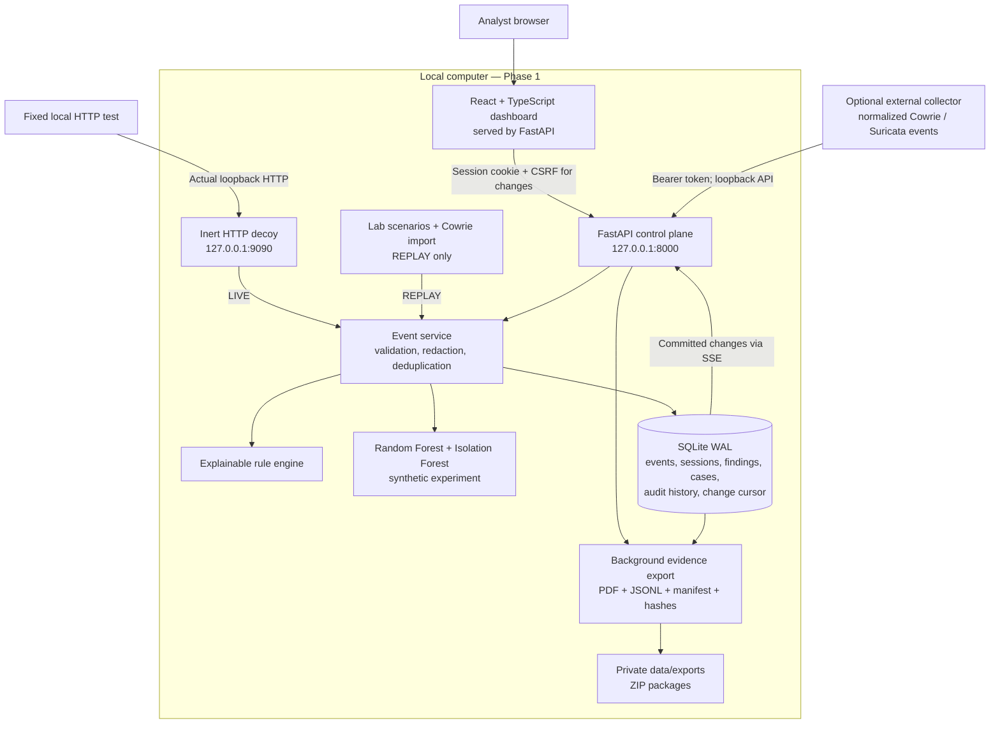
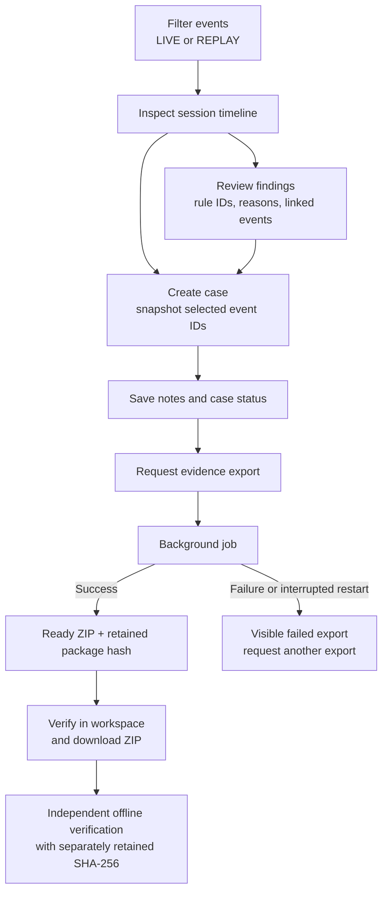
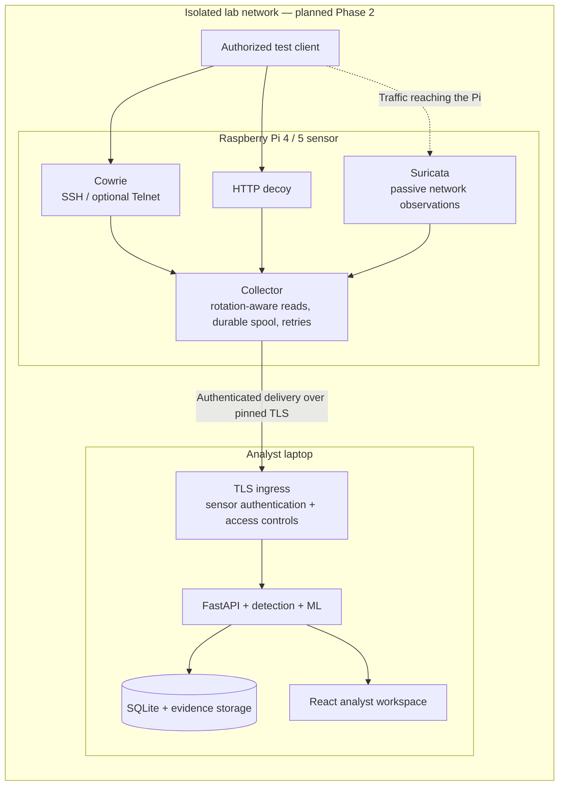

# SentinelPi

**Intelligent Raspberry Pi-Based Honeypot for Cyber Attack Detection, Logging and Forensic Analysis**

SentinelPi connects honeypot observations to an analyst workflow: collect events, explain suspicious behavior, investigate sessions, and export verifiable evidence. Its local workspace combines a React dashboard, a Python API, explainable detection rules, and a synthetic machine-learning experiment.

> **Release status: Phase 1 — working local software platform.** The HTTP decoy runs on your computer. Raspberry Pi deployment, live SSH/Telnet collection, passive network capture, and real-capture ML evaluation are Phase 2 work. Generated and imported replay records are labeled separately from live observations.

**Runs locally · No paid API or cloud account required · MIT licensed**

## Contents

- [What the system does](#what-the-system-does)
- [Quick start](#quick-start)
- [System architecture](#system-architecture)
- [Event processing workflow](#event-processing-workflow)
- [Investigation and evidence workflow](#investigation-and-evidence-workflow)
- [Detection and machine learning](#detection-and-machine-learning)
- [API and authentication](#api-and-authentication)
- [Configuration](#configuration)
- [Development and validation](#development-and-validation)
- [Repository layout](#repository-layout)
- [Raspberry Pi deployment roadmap](#raspberry-pi-deployment-roadmap)
- [Security and operational boundaries](#security-and-operational-boundaries)
- [Troubleshooting](#troubleshooting)
- [Documentation](#documentation)
- [License](#license)

## What the system does

- **Observe:** an inert HTTP decoy records actual local requests and failed form logins. A separate authenticated API accepts normalized Cowrie/Suricata events from an external collector.
- **Preserve:** SQLite WAL stores normalized events, preserved redacted envelopes, source and receipt timestamps, session groupings, and an ingestion hash chain.
- **Detect:** versioned rules identify scan patterns, repeated authentication failures, HTTP path enumeration, and command intent, with saved reasons and linked records.
- **Investigate:** search activity, inspect session timelines, review findings, create cases, and save analyst notes through the React/TypeScript workspace.
- **Explain:** a Random Forest classifier and Isolation Forest provide provisional behavior and novelty estimates from a reproducible synthetic benchmark.
- **Export:** background jobs produce a case PDF and evidence ZIP with manifests, checksums, and package-hash verification.

### Live software and lab replay

**LIVE** contains actual observations from the local HTTP decoy or events accepted through the credentialed external collector endpoint. Acceptance through that endpoint does not establish that a Raspberry Pi is deployed.

**REPLAY** contains generated lab scenarios and imported Cowrie records. A fresh workspace seeds 192 generated records when replay seeding is enabled. Guided scenarios cover scans, authentication guessing, shell interaction, HTTP enumeration, and low-interaction control activity. They do not execute network attacks or shell commands.

The two modes have separate dashboard counts and investigation views. Repeated demonstrations accumulate records. Charts show source event time over the last hour; headline counts cover all stored records in the selected mode.

## Quick start

### Requirements

- Windows with PowerShell for the included launcher.
- Python 3.11 or newer; the recorded validation used Python 3.12.14.
- Node.js 22 LTS and npm for building the frontend; the recorded validation used Node.js 22.13.0.
- Internet access for the initial dependency installation. The installed local application, fonts, rules, synthetic model, and exports work offline.

A Raspberry Pi is not required to run Phase 1. See the [validation record](docs/validation.md) for the tested environment and remaining hardware checks.

### Launch the workspace

From the repository folder, double-click **[Start-SentinelPi.cmd](Start-SentinelPi.cmd)** or run:

```powershell
.\Start-SentinelPi.cmd
```

The launcher creates `.venv` if needed, installs the pinned Python dependencies and locked frontend dependencies, builds the UI, and starts the backend. FastAPI serves the built dashboard, so no separate frontend server is needed.

- **Analyst workspace:** http://127.0.0.1:8000
- **HTTP decoy:** http://127.0.0.1:9090

Sign in with the generated username and password printed in the terminal. They are also stored in `data/local-credentials.json`, which is ignored by Git. Keep that file private. Leave the terminal open; **Ctrl+C** stops the application and decoy.

After a successful build, use the faster repeat launch:

```powershell
.\tools\start.ps1 -SkipBuild
```

To launch without opening a browser:

```powershell
.\tools\start.ps1 -SkipBuild -NoBrowser
```

If PowerShell blocks a directly invoked script, use the CMD launcher. Its execution-policy argument applies only to that PowerShell process.

### First investigation

1. Sign in and open **System health** to confirm that the local HTTP decoy is online.
2. Open **Lab console → Run local HTTP test**. This sends 14 GET requests and six failed form logins to the fixed loopback decoy.
3. Inspect the resulting **Live software** records, rule findings, and session timeline.
4. Run **Guided replay** to explore the scan and SSH investigation paths with explicitly generated data.
5. Create a case from a finding or session, save notes, export the evidence, and verify the package.
6. Open **Intelligence** and **Project roadmap** to review model provenance and the hardware work still planned.

See the [evaluation guide](docs/evaluation-guide.md) for a complete demonstration script.

## System architecture

### Current implementation — Phase 1

The control plane and HTTP decoy run on one computer. The decoy has its own loopback port; browser sessions and collector ingestion use different credentials.



**Frontend:** React 19, TypeScript, Vite, Recharts, Lucide icons, and bundled fonts. The workspace includes overview, activity, sessions, findings, evidence, lab, intelligence, health, and roadmap views.

**Backend:** Python, FastAPI, Pydantic, and Uvicorn handle request validation, authentication, ingestion, queries, streaming updates, and background exports. The HTTP decoy uses Python's HTTP server and submits observations directly to the event service.

**Storage:** SQLite uses WAL with serialized transactions and `synchronous=FULL`. Schema version 1 stores events, sessions, findings, cases, exports, sensors, users, authentication sessions, audit history, and durable change records. Runtime files stay in the private `data/` directory by default.

**Analysis and reporting:** scikit-learn implements the synthetic model experiment; ReportLab generates case PDFs. Evidence packages remain ordinary ZIP/JSONL files that can be verified independently.

### Architecture documents

The [original architecture proposal](docs/architecture.md), [overview SVG](docs/diagrams/architecture.svg), and [architecture PDF](output/pdf/honeypot-system-architecture.pdf) describe the broader target design. They include planned components and acceptance targets; the diagram above describes the software implemented today.

## Event processing workflow

All sources converge on the same event service. LIVE/REPLAY provenance is assigned by the collection path, and sessions are namespaced by mode, sensor, and source session ID.

```mermaid
sequenceDiagram
    participant Source as Decoy / replay / collector
    participant Ingest as Collection entry point
    participant Service as Event service
    participant DB as SQLite transaction
    participant Analysis as Rules + provisional ML
    participant Stream as SSE endpoint
    participant UI as Analyst dashboard

    Source->>Ingest: Submit observation or bounded batch
    Ingest->>Ingest: Validate input and assign trusted mode / sensor
    Ingest->>Service: Process normalized events
    Service->>Service: Redact credential metadata
    Service->>DB: Begin transaction and check event IDs
    alt Same ID with different payload or mode
        Service->>DB: Roll back batch
        Service-->>Ingest: Conflict
        Ingest-->>Source: Reject conflicting batch
    else Valid batch
        opt Identical events already stored
            DB-->>Service: Mark identical retries as duplicates
        end
        opt New events in batch
            Service->>DB: Preserve envelope + hash link; update session
            Service->>Analysis: Evaluate rules and session features
            Analysis->>DB: Save prediction, findings, and change records
        end
        Service->>DB: Commit transaction
        Service-->>Ingest: Outcomes + committed cursor
        Ingest-->>Source: Acknowledge successful batch
    end
    Stream->>DB: Read committed changes after cursor
    Stream-->>UI: Change event with monotonic ID
    UI->>Ingest: Refresh relevant views
```

- **Idempotency:** identical retries are duplicates; reusing an event ID with a different normalized payload or mode rejects the batch and rolls back its writes.
- **Time:** timezone-aware source timestamps are normalized to UTC; receipt timestamps are retained separately. Device timestamps more than five minutes in the future are rejected.
- **Integrity:** each preserved redacted envelope receives a SHA-256 link to the preceding event hash. The chain spans both modes in ingestion order.
- **Updates:** Server-Sent Events (SSE) expose persisted changes after commit. Reconnection supports a cursor and `Last-Event-ID`; the UI also reconciles periodically.
- **Bounds:** API bodies are limited to 512 KiB, ingestion batches to 100 events, event details to 4,096 characters, and metadata to 8 KiB JSON.

## Investigation and evidence workflow



Cases retain the event selection captured at creation; later observations do not automatically expand the case. A case can select at most 2,000 events, and at most two exports may be pending.

Each evidence ZIP contains:

```text
EXP-<id>.zip
├── events.jsonl             # Normalized selected events
├── redacted-records.jsonl   # Preserved envelopes and ingestion hash links
├── report.pdf              # Case notes, provenance, first 150 records
├── manifest.json           # Scope, versions, event count, file hashes and sizes
└── SHA256SUMS               # Checksums for the report, records, and manifest
```

The JSONL files include the complete selected dataset even when the PDF reaches its 150-record display limit. Exports contain redacted records; original Cowrie files, complete transcripts, and PCAP acquisition remain Phase 2.

Retain the package SHA-256 separately, then verify a downloaded export without extracting or executing its contents:

```powershell
.\.venv\Scripts\python.exe tools/verify_evidence.py .\path\to\export.zip --expected-sha256 YOUR_SEPARATELY_RETAINED_SHA256
```

To check the local database ingestion chain:

```powershell
.\.venv\Scripts\python.exe -m backend.cli verify
```

Checksums establish byte equality against an anchor. A local privileged attacker could rewrite both records and a locally stored anchor; a case selection may also be a noncontiguous subset of the ingestion chain.

## Detection and machine learning

### Explainable rules

Rules evaluate observations within the same mode, sensor, and source IP using source event time. Findings retain the rule version, reason, severity, occurrence count, and linked event IDs.

- **`SCAN-001` — TCP scan:** at least 10 distinct destination ports from `tcp_probe` events within 10 seconds; medium severity. Repeated probes to the same port do not increase the distinct-port count.
- **`AUTH-001` — Authentication guessing:** at least five failed logins within 60 seconds; high severity.
- **`HTTP-001` — HTTP enumeration:** at least 10 HTTP requests across at least three paths within 60 seconds; medium severity.
- **`CMD-001` — Shell interaction:** records an emulated command as inert text; low severity.
- **`CMD-002` — Download or persistence intent:** matches strings such as `wget`, `curl`, `/etc/cron`, `crontab`, or `chmod +x`; high severity. Matching indicates intent, not successful execution.

Findings are grouped by mode, sensor, source IP, rule ID, and fixed source-time minute bucket. These are bounded pattern rules, not complete coverage of every scanning or exploitation technique.

### Synthetic ML experiment

The current experiment generates **400 synthetic feature rows**, representing 80 independent generated runs for each of five behaviors: control, scan, authentication guessing, shell activity, and HTTP probing. A group-based 75%/25% split separates training from holdout runs.

- A **Random Forest** produces a provisional primary behavior estimate; confidence below `0.60` is shown as uncertain.
- An **Isolation Forest**, fitted to synthetic control examples from the training split, produces a separate novelty score.
- Features include event count, distinct ports, login failures, command count, HTTP request count, distinct paths, and duration.
- The **Intelligence** view exposes computed metrics, confusion matrix, feature importance, seeds, and dataset/feature-schema hashes. The evaluation manifest is written to `data/model-evaluation.json`.

These scores describe a synthetic feasibility benchmark. They do not measure real-network detection accuracy, and classifier confidence is not the probability that an IP is malicious. Rules remain available when the model is unavailable. Real captures, day-separated validation, threshold calibration, and comparisons against a rule-only baseline remain Phase 2.

## API and authentication

The default API base is `http://127.0.0.1:8000/api`. See [API and data notes](docs/api-and-data.md) for the complete route list, schemas, and limits.

- **Browser access:** generated local credentials establish a session using an `HttpOnly`, `SameSite=Strict` cookie. Authenticated mutations require `X-CSRF-Token`; Host and Origin checks constrain requests.
- **Collector access:** `POST /api/ingest/batches` and `POST /api/sensors/heartbeat` use a separate bearer `sensor_token`. Ingested events are bound to `external-sensor` and `LIVE` by the server. The token grants no analyst query or export access.
- **Investigation:** `/events`, `/sessions`, `/findings`, `/cases`, and `/summary` expose the analyst workflow.
- **Evidence:** `/cases/{id}/exports`, `/exports/{id}/download`, `/exports/{id}/verify`, and `/integrity` support export and verification.
- **Updates and health:** `/stream` provides SSE changes, `/sensors` and `/system` show authenticated health details, and `/health` is public.
- **Schema:** `/api/openapi.json` requires analyst authentication. Interactive Swagger/ReDoc pages are disabled.

Cowrie imports support session connect/close, failed/successful login, and command-input records. Imports always enter REPLAY; other event types are skipped. The ingestion API exists today, while the durable Raspberry Pi collector is still planned.

## Configuration

Supported environment variables are read when the application starts:

- **`SENTINEL_DATA_DIR`** — runtime storage directory; defaults to this repository's `data/`.
- **`SENTINEL_DECOY_PORT`** — loopback HTTP decoy port; defaults to `9090`.
- **`SENTINEL_SEED_REPLAY`** — set to `0` to disable automatic replay seeding; defaults to `1`. Existing records are preserved.

For example, to use another decoy port:

```powershell
$env:SENTINEL_DECOY_PORT = '9091'
.\tools\start.ps1 -SkipBuild
```

The guided live test follows the configured decoy port. The launcher and Vite proxy use API port `8000`. The CLI accepts `serve --port`, but changing the API port also requires reviewing the configured browser origins and development proxy. Keep the default for the documented workflow.

## Development and validation

### Manual setup

Run these commands from the repository root if you want to install and start each component explicitly:

```powershell
python -m venv .venv
.\.venv\Scripts\python.exe -m pip install -r backend/requirements.txt
Push-Location frontend
npm ci
npm run build
Pop-Location
.\.venv\Scripts\python.exe -m backend.cli serve
```

### Frontend hot reload

Start the backend in one terminal:

```powershell
.\.venv\Scripts\python.exe -m backend.cli serve
```

In another terminal:

```powershell
cd frontend
npm run dev
```

Open the local URL printed by Vite, normally `http://127.0.0.1:5173`. Vite proxies `/api` to `http://127.0.0.1:8000`; the production build is served directly by FastAPI.

### Checks

```powershell
.\.venv\Scripts\python.exe -m pytest -q
.\.venv\Scripts\python.exe -m pip check
Push-Location frontend
npm run build
npm audit
Pop-Location
```

The backend suite covers authentication boundaries, namespace isolation, idempotency and rollback, detection thresholds, redaction, pagination, evidence tampering, restart persistence, live loopback collection, model reproducibility, and request bounds. The [validation record](docs/validation.md) documents the checks run on 17 October 2026; it is not a current dependency audit or a hardware certification.

## Repository layout

```text
RaspberryHonepotSystem/
├── Start-SentinelPi.cmd       # Windows entry point
├── backend/
│   ├── cli.py                # Serve, display credentials, verify chain
│   ├── requirements.txt      # Pinned Python dependencies
│   ├── app/
│   │   ├── api.py            # Routes, middleware, lifecycle, exports
│   │   ├── auth.py           # Analyst sessions and collector authentication
│   │   ├── config.py         # Runtime settings
│   │   ├── database.py       # SQLite schema, transactions, integrity
│   │   ├── schemas.py        # Typed request and event models
│   │   ├── service.py        # Ingestion, redaction, sessions, queries
│   │   ├── detection.py      # Rules and session features
│   │   ├── ml.py             # Synthetic training and provisional inference
│   │   ├── decoy.py          # Actual loopback HTTP collection
│   │   ├── lab.py            # Generated replay and fixed local probe
│   │   └── evidence.py       # ZIP/PDF creation and verification
│   └── tests/                # Integration and regression suite
├── frontend/
│   ├── src/                  # React workspace, styles, typed API client
│   └── vite.config.ts        # Build configuration and development proxy
├── tools/                    # Launcher, offline verifier, architecture generator
├── docs/                     # Architecture, API, scope, evaluation, literature
│   └── diagrams/             # Original target architecture SVG and Mermaid
├── output/pdf/               # Architecture PDF
└── data/                     # Private runtime files; ignored by Git
```

## Raspberry Pi deployment roadmap

The planned deployment separates the attack-facing Pi sensor from the laptop that hosts analysis, storage, and the analyst workspace. **The topology below is a Phase 2 target, not the current deployment.**



Phase 2 work includes:

- **Hardware deployment:** ARM64 compatibility, systemd services, Ethernet lab setup, and CPU/memory/storage profiling.
- **Real sensor collection:** Cowrie SSH/Telnet events and Suricata observations, including probes to closed ports.
- **Reliable transport and isolation:** durable edge queues, retries, clock-drift handling, pinned TLS, token rotation, separate service users, and firewall policies.
- **Complete acquisition:** rotation-aware original file transfer, bounded PCAP collection, storage retention, and recovery testing.
- **Measured evaluation:** reviewed real-capture datasets, independent-day splits, rule/model comparisons, negative containment tests, and a 24-hour soak.

Consult the [architecture proposal](docs/architecture.md) for the planned port map, trust boundaries, and acceptance targets, and [Phase 1 scope](docs/phase-one.md) for the implemented release boundary.

## Security and operational boundaries

This is a local research release. Keep the loopback binding and use the decoy only in an authorized lab. The live test accepts no remote target, replay uses documentation addresses, and captured commands remain inert text.

- **Access:** Phase 1 has one analyst role. TLS, credential rotation, stronger service isolation, and production deployment controls remain further work.
- **Privacy:** credential metadata keys are redacted recursively and HTTP form passwords are not retained. Commands, paths, notes, and imported data still need appropriate handling; never commit runtime data or evidence.
- **Integrity:** hash chains and export checksums support verification against retained anchors. They do not establish attacker identity, successful exploitation, independent authenticity, or legal certification.
- **Storage:** use one server worker and do not manually modify schema version 1. Bounded requests do not provide disk retention. Back up with SQLite's backup API and protect private export storage.
- **Recovery:** pending exports interrupted by restart become visibly failed and can be requested again. Phase 1 has no durable edge delivery queue.
- **Coverage:** detection records observations and patterns. Network-wide prevention, complete packet acquisition, field ML accuracy, and Raspberry Pi reliability have not been established.

## Troubleshooting

- **Port 8000 is busy:** if SentinelPi is already running, open its workspace. Otherwise, stop the existing service through its own terminal before relaunching.
- **The decoy is offline or port 9090 is occupied:** inspect **System health**, resolve the conflict, or set `SENTINEL_DECOY_PORT` before restarting. The dashboard can start even when the decoy fails to bind.
- **The API reports that the frontend is not built:** run `npm ci` and `npm run build` in `frontend/`, then restart the backend.
- **You need the sign-in details:** run `.\.venv\Scripts\python.exe -m backend.cli credentials` locally. Avoid sharing the output.
- **The replay chart is quiet:** choose **Lab console → Load 1-hour replay** to add 192 generated records across the preceding hour. Existing data and LIVE counts remain intact.
- **A live test is rate-limited:** wait at least five seconds before running another test.
- **An export failed after a restart:** request a new export from the case and wait for **Ready** before downloading or verifying it.
- **Commands cannot find Python or npm:** install the prerequisites and reopen the terminal so the updated PATH is available.

## Documentation

- [Architecture proposal](docs/architecture.md) — original target design, rationale, isolation, and evaluation plan.
- [Architecture PDF](output/pdf/honeypot-system-architecture.pdf) — shareable design document.
- [Phase 1 scope](docs/phase-one.md) — implemented capabilities and deferred work.
- [API and data contracts](docs/api-and-data.md) — routes, authentication, limits, persistence, and provenance.
- [Evaluation guide](docs/evaluation-guide.md) — step-by-step demonstration and explanation prompts.
- [Validation record](docs/validation.md) — dated automated and running-server checks.
- [Literature review](docs/literature-review.md) — research context and primary references.
- [Editable architecture content](docs/architecture.json) — source consumed by `tools/build_architecture.py`; documentation-generation dependencies are in `tools/requirements-docs.txt`.

The Mermaid diagrams in this README render directly on GitHub. Open the source in a Mermaid-enabled Markdown viewer for local rendering.

## License

Released under the [MIT License](LICENSE). Copyright © 2026 Sandesh Bramhane. Third-party dependencies retain their respective licenses.
