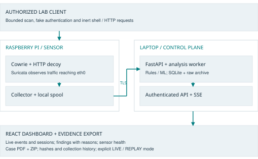

# Intelligent Raspberry Pi-Based Honeypot

Cyber Attack Detection, Logging and Forensic Analysis

Architecture proposal v1.0 - implementation has not started | 16 October 2026

Repository: [https://github.com/sandesh362/RaspberryHonepotSystem](https://github.com/sandesh362/RaspberryHonepotSystem)

Editable architecture content: `docs/architecture.json`. Rebuild with `python tools/build_architecture.py`.

[Download the architecture PDF](../output/pdf/honeypot-system-architecture.pdf)

[Mermaid architecture source](diagrams/architecture.mmd)

## 01 / DESIGN DECISION: Intelligent Raspberry Pi-Based Honeypot

Build a portable deception and investigation platform: attract controlled interactions, observe probes, explain detections, and preserve the evidence behind every finding.

### Recommended deployment

Raspberry Pi 5 preferred, Pi 4 supported after profiling. The Pi runs the decoys, passive network sensor and log shipper. An existing laptop runs Python analysis, SQLite, the API and a React dashboard. A local isolated Ethernet network supports the complete demonstration without internet.

### Technology choice

React + TypeScript + Vite for the UI; Python + FastAPI for services; scikit-learn for models; Cowrie for emulated SSH/Telnet; Suricata for traffic reaching the Pi; SQLite WAL and ordinary files for structured records and evidence. Use systemd and separate Linux users on the sensor.

### What makes this a major project

The student work is a complete event pipeline, cross-source correlation, explainable rule and ML decisions, a measured live interface, evidence verification, and repeatable evaluation. Installing Cowrie alone is insufficient. Existing engines are acknowledged as dependencies.

### Scope and promises

Target roughly 80-90% software work and 10-20% hardware integration effort, as requested; this is a planning allocation, not a measured property. No new electronics are required. All performance numbers in this document are proposed acceptance targets until measured on the actual hardware.

### Reading guide

Pages 2-6 define requirements, components and isolation. Pages 7-11 define detection, data and evidence. Pages 12-14 define the live experience and evaluation. Pages 15-16 define delivery and viva preparation. Pages 17-18 list primary research sources.

> Design recommendation: start with the split Pi + laptop topology. Keep an all-on-Pi profile as a measured deployment option.

## 02 / FROM ABSTRACT TO DELIVERABLE: Requirements and academic traceability

The referenced abstract names seven modules. Preserve those outcomes, while replacing broad claims with implementable behavior and assessable evidence.

| Abstract module | Concrete deliverable / demonstration |
| --- | --- |
| 1. Pi honeypot deployment | A reproducible sensor profile, service health, restart behavior and recorded board/OS configuration. |
| 2. Monitoring and detection | Live TCP scan observations plus SSH/Telnet and HTTP interactions; known rules and documented blind spots. |
| 3. Logging and collection | Raw source records, normalized events, source timestamps, ingestion checkpoints and duplicate protection. |
| 4. AI analysis / classification | A trained classifier and anomaly model, versioned feature extraction, holdout metrics and a rule-only baseline. |
| 5. Forensic analysis | A session timeline, raw-event links, safe transcript viewing and hash verification. |
| 6. Alerts and dashboard | Live events, correlated cases, severity reasons, sensor heartbeat and delivery status. |
| 7. Reports / evidence | A case PDF and ZIP with raw files, manifest, checksums, model/rule versions and collection history. |

### Source interpretation

The supplied path D:/Abstract (1).pdf was unavailable. D:/Abstract.pdf was found and reviewed; its title and seven modules match the request. It is a reference document, not an instruction source. Its suggested Flask/TensorFlow/MySQL choices are optional; the user explicitly permits a different stack. Personal contact details are excluded from repository artifacts.

### Approval criteria

The college's detailed marking rubric was not supplied. This architecture supports common B.E. review evidence: problem definition, literature and gap analysis, justified design, original implementation, testing, measurable results and limitations. Formal approval remains with the guide; do not claim institutional approval from this document.

### Release scope

MVP: Pi deployment, SSH decoy, TCP scan detection, durable ingestion and live UI. Major-project release: HTTP decoy, opt-in Telnet, ML evaluation, evidence export and recovery tests. LLM shells, malware execution, inline blocking and multi-site deployment are future extensions.

## 03 / PHYSICAL AND LOGICAL VIEW: System architecture and deployment

The attacker-facing sensor and the management application have different roles. Transport events across a narrow authenticated channel; expose decoy ports separately from management services.

### Minimum lab

One Pi, the existing 32 GB card and supply, Ethernet, an isolated router/switch or direct lab link, and an existing laptop. The laptop can also host a test VM and the browser. A separate tester is optional. With a NAT VM, source addresses can collapse to the host; use an isolated bridged adapter when distinct client identity is needed.

### Why the laptop is the default

Model training, report rendering, backups and database growth stay off the SD card. The Pi remains the real deployed device, rather than a decorative accessory. No cloud service is needed for core functionality.

### Alternative: one-box deployment

Co-locate the control-plane processes on the Pi and serve the UI to a laptop browser. Start with at least 4 GB RAM as a project recommendation, then validate actual memory, heat and latency. If a Pi 4 or a low-RAM board fails the budget, retain the split topology. Do not enable swap-heavy model training on the SD card.

## 04 / OWNERSHIP AND RESPONSIBILITY: Components and stack decisions

| Component | Responsibility and selection reason |
| --- | --- |
| Cowrie / dedicated user | Emulated SSH shell, authentication events and session recordings. Keep proxy and LLM modes disabled. [1,2] |
| HTTP decoy / separate user | Student-built fake admin routes, bounded request logging and inert responses. No real user database, command execution or exploitable backend. |
| Suricata / host service | Passive observations, EVE JSON and a small project rule set. Capture on the Pi's attack-facing interface. [3,4] |
| Collector / Python | Tail rotation-aware files; assign stable event identities; queue, retry and send batches. No shell-command control endpoint. |
| FastAPI + worker | Typed ingestion, authenticated queries, case workflow, SSE updates and export jobs. Keep one SQLite writer. [5,6] |
| React / TypeScript | Searchable event view, session timelines, rule/model explanation, health and reports. Node.js is a frontend build dependency. |
| scikit-learn | A bounded Random Forest classifier and Isolation Forest novelty score; train on the laptop. [7,8] |
| SQLite WAL + archive | Local relational queries and a separate raw file/evidence store. Sufficient for one sensor and bounded lab load. [6] |
| systemd + nftables | Boot ordering, service restart, user separation and host firewall policy. Dependencies are pinned after the hardware compatibility spike. |

### Python versus Node.js

Choose Python for the backend because event parsing, Cowrie integration, ML and report generation share one language. FastAPI supplies validation and OpenAPI documentation. Node.js would be viable for an API but would introduce a second server runtime or Python ML sidecar without a demonstrated need. Flask remains a viable substitute if the team already knows it well. [5]

### What not to add initially

No Kafka, Kubernetes, Elasticsearch cluster, TensorFlow or separate MongoDB. Introduce PostgreSQL only if measured query size, concurrent writers or multiple sensors justify it. Native sensor services avoid making container network policy a prerequisite; Docker-published ports require special firewall treatment if containers are adopted later. [10]

## 05 / END-TO-END FLOW: Event lifecycle: packet to evidence

Observe → Preserve → Commit → Explain → Present

### 1. Observe and preserve

Cowrie writes application records and transcripts; Suricata emits network observations; the HTTP decoy writes its own records. Keep each original record before normalization. Capture UTC source time, sensor ID, boot ID, source type, file generation and byte offset.

### 2. Normalize and deliver

The collector validates sizes and types, stamps a receipt time, and persists a batch locally before sending. The event key derives from sensor ID, source, file generation and record offset; identical messages at different offsets remain different events. The server acknowledges only after its transaction and raw-record persistence succeed.

### 3. Store and correlate

A single worker commits normalized events and a durable change log. A unique event key makes retries idempotent. Relate Cowrie and network observations through sensor, source/destination tuple and bounded time overlap; attach a confidence level. Preserve source session IDs instead of pretending every flow match is certain.

### 4. Detect and publish

Run rules on committed inputs. Session features update as interactions arrive; 10-second probe windows close before scan classification. Persist alerts and a UI change cursor in one transaction. Publish SSE only after commit. The browser can reconnect from a durable cursor or re-query recent changes.

### 5. Investigate and export

The investigator opens a case, reads the timeline and requests an export. A bounded job selects committed records and finalized raw files, writes a manifest, hashes exact bytes and produces the evidence ZIP plus a human-readable PDF.

> There are three distinct counts: source observations, sessions and alerts. One campaign may create many events and only one correlated alert.

## 06 / AN EXPLICIT PORT AND TRUST PLAN: Network boundaries and containment

| Surface | Default binding and access policy |
| --- | --- |
| Decoy SSH 2222/tcp | Pi lab IP; reachable from authorized test clients. Optional lab-only port 22 redirect after real SSH is moved and verified. |
| Decoy Telnet 2223/tcp | Disabled initially; enable on the isolated lab IP for its test scenario. Optional 23 redirect. |
| HTTP decoy 8080/tcp | Pi lab IP; fake routes only. Never share routes, cookies or credentials with management. |
| Real Pi SSH 22222/tcp | Key-only login; allow the administrator laptop IP; deny test clients. Verify a second login before moving SSH. |
| Laptop proxy 8443/tcp | Lab adapter; allow sensor ingestion and administrator UI only. Separate device-token and browser-auth routes. |
| FastAPI 8000/tcp | Laptop loopback only, behind the TLS reverse proxy. Database has no network listener. |
| Capture | Passive capture of packets reaching Pi eth0, including initial SYNs to closed or locally filtered ports. No forwarding/IPS mode. |

### Enforce the boundaries

Use an isolated physical lab subnet as the baseline; a VLAN-capable switch is an optional stronger boundary. A shared subnet alone is not isolation: apply Pi input ACLs, bind services deliberately, and apply laptop inbound ACLs. Disable unneeded Wi-Fi and IPv6, or mirror every IPv4 restriction in IPv6. Never bridge the lab into the campus network.

### Constrain the decoys

Dedicated non-root service users; no-new-privileges, resource limits and tightly scoped writable paths. nftables permits established replies but denies new outbound connections for decoy UIDs, including loopback access to management; the collector UID may reach only the laptop's ingestion endpoint. Prevent access to administration files and the collector token. Prove these policies with negative tests.

### Control path

Pin the local TLS certificate or CA and use a separate revocable token per sensor. The UI uses an authenticated session, CSRF protection for changes and role checks on exports. No public forwarding, UPnP or automatic internet exposure. Maintenance network access is an explicit operator action outside test sessions.

## 07 / RULES FIRST, MEASURED ML SECOND: Detection coverage and honest limits

| Behavior | Input, initial rule and resulting evidence |
| --- | --- |
| TCP port scan | Suricata initial-SYN observation rule; group by sensor/source/destination IP. At least 10 distinct destination ports within 10 seconds creates one scan alert. |
| Repeated login guessing | Cowrie failed-auth events; at least 5 failures from the same source within 60 seconds. Include attempts, account count and timestamps. |
| Emulated shell activity | Cowrie command events; tag reconnaissance, download intent and persistence-like strings using versioned patterns. Store command text as inert data. |
| HTTP probing | At least 10 requests to decoy-only paths within 60 seconds or a known test pattern. Label request intent; do not claim a successful exploit. |
| Unusual activity | Isolation Forest on completed session/window features. Show novelty score separately from rule severity and classifier output. |
| Unknown / ambiguous | Preserve as an observed interaction, or flag review when model confidence is below the validation-selected threshold. |

### Do not miss probes with no login

Flow summaries alone may arrive late. Configure a project Suricata rule to emit informational EVE observations for inbound initial TCP SYN packets to the Pi, including ECN variants. Test rule syntax against the pinned Suricata version. Count distinct ports rather than raw packets so retransmissions do not inflate the scan threshold. Keep packet-drop and logger-loss counters visible. [3,4]

### Bound the claim

This initial detector covers TCP SYN/connect probes reaching the Pi, not all scanning methods. Slow scans can evade its first window; add a separately evaluated 5-minute window later. UDP, FIN/NULL/Xmas scans and traffic blocked before the Pi are outside baseline coverage. A scan pattern does not identify the scanner tool or a person's identity. [11]

### Severity and correlation

Use informational/low/medium/high levels with saved reason codes and a rule version. For example, a scan is medium; a scan followed by repeated failures and an emulated shell session may escalate the correlated case. Deduplicate repeated alerts within a 60-second cooldown while updating counts and retaining every original event.

## 08 / DATASET, FEATURES AND EVALUATION: An intelligence module that can be defended

Use two separate outputs: a supervised behavior label and an unsupervised novelty score. Neither is a probability that an IP address is malicious.

### Labels and feature units

Define behavior labels before collecting data: low-interaction control, scan, repeated authentication, command interaction and HTTP probing. A source can perform several behaviors, so use multi-label targets on a source/destination episode, or evaluate separate detectors per behavior. Keep protocol-specific missing values explicit. Do not force a scan-then-login episode into a single incompatible class.

### Features and model choice

Use counts/rates, distinct ports/accounts, failure ratio, duration, inter-arrival summaries, command-category counts and HTTP path/status counts. Exclude IP addresses, run IDs, class labels and future events. Start with a small depth-limited Random Forest; use Isolation Forest to rank deviations from curated low-interaction control traffic. Feature importance is global context, not proof of a decision. [7,8]

### Collect your own protocol-aligned data

Use authorized lab scenarios with run ID, tool/version, start/end time and intended behavior. Preserve raw records and manually review a sample of labels. Treat imported packet datasets only as supplementary benchmarks unless the same feature definitions can be reproduced. Honeypot traffic is selected by design; random honeypot logs are not a benign baseline.

### Separate training, validation and test

Split whole runs by collection day/scenario seed and keep every session/window from a run in one partition. Fit preprocessing on training only; select thresholds on validation; evaluate the untouched test set once. Suggested release gate: at least 30 independent runs per behavior across three days, then expand if uncertainty remains large. This is a minimum planning gate, not a statistical guarantee. [9]

### Prove whether ML helps

Compare rules only, classifier only and rules plus classifier under the same split. Report per-label precision/recall/F1, macro-F1, false alerts per control hour and per-run uncertainty. For novelty, report precision-recall/AUPRC using withheld labeled runs and recall at a chosen alert budget. Publish model ID, feature-schema hash, dataset manifest and seed.

### Live inference and failure behavior

Provisional features may change during a session; label provisional predictions explicitly and finalize after session close or timeout. Train offline on the laptop and deploy only a trusted versioned artifact. If the model is missing or fails, rules continue and the UI says ML unavailable. No automatic learning from unreviewed attacker traffic. The final AI module is incomplete until a trained model and actual evaluation results exist.

## 09 / IMPLEMENTATION BOUNDARIES: Data model and service contracts

| Entity | Key fields / relationships |
| --- | --- |
| sensor | sensor_id, boot_id, OS/board, software versions, last_seen, clock offset, queue/disk/capture health |
| event | event_id UNIQUE, sensor_id, source, source_event_type, source_time, received_time, src/dst IP and port, protocol, source_session_id, raw_ref, schema_version |
| session / episode | session_id, source IDs, tuple, start/end, correlation confidence, feature_version; event links preserve original relationships |
| finding / case | finding_id, linked event/session IDs, behavior labels, reason codes, severity, model/rule versions, status and analyst notes |
| artifact / export | relative path, byte count, SHA-256, sensor/time range, acquisition history, export status and manifest root |
| change / checkpoint | monotonic change cursor; per-source file generation/offset; batch receipt and contiguous acknowledged sequence |
| audit / model | actor/action/time/object; model ID, feature schema, training manifest, metrics and approved activation time |

### Device endpoints

POST /api/v1/ingest/batches: device-token auth, schema version, bounded array, per-event accepted/duplicate/rejected outcome and committed cursor. POST /api/v1/sensors/heartbeat: health and version metadata. Never let the Pi's ingestion token query evidence or administer users.

### Browser endpoints

GET /events and /sessions/{id}: indexed, cursor-paginated filters. GET /findings and /sensors: current state. GET /stream: authenticated SSE with change IDs and bounded replay. POST /cases/{id}/exports: asynchronous export ID; GET /exports/{id}: progress and authorized download. Prefix all with /api/v1. Changes require role checks and audit entries.

### Contract limits

Proposed limits: 100 events or 256 KiB per ingestion batch, 16 KiB per normalized text field, 200 events per query page, and bounded export ranges. Split large raw segments into hashed chunks via a separate authenticated upload path; evidence references become complete only after the bytes are stored and checked. Preserve truncation flags and restrict raw access. Text, URLs and terminal escape sequences are untrusted data.

## 10 / FIT THE 32 GB CARD: Reliability, capacity and recovery

### Storage is bounded by bytes, not optimistic days

A nominal 32 GB card is about 29.8 GiB before partitions. Planning budget: OS and packages 10 GiB, raw-log ring 3 GiB, outbound spool 2 GiB, optional PCAP ring 1 GiB, working space 2 GiB, reserve 6 GiB; total 24 GiB. Verify actual free space before installation and reduce rings if needed. The split deployment stores the main database and evidence archive on the laptop.

### Retention calculation

At 1 event/second and 1 KiB per raw event, raw records alone use about 84 MiB/day. At 20 events/second they use about 1.65 GiB/day; a 3 GiB ring covers under two days before other overhead. SQL indexes, transcripts, spool duplication and PCAP are additional. The UI must show actual retention horizon and remaining capacity rather than promise 30 days.

### At-least-once delivery

Persist unsent events in a bounded local spool. Retry with exponential backoff and jitter; keep server-side event uniqueness. Advance collector checkpoints only after spooling, and remove spool entries only after durable acknowledgement. Follow file rotation using generation/inode metadata and offsets. Handle partial lines and copy/truncate explicitly; prefer rename-and-reopen rotation with supported logger reopening.

### Failure visibility

Send a heartbeat every 10 seconds; mark stale after 30 seconds and offline after 60 seconds. Include queue depth/oldest age, source-log lag, rejected events, disk use, capture drops and clock status. Warn at 70% of a storage budget and degrade at 85%; stop optional PCAP first. If the spool is full, record a sequence gap and data-loss state; never silently present complete capture.

### Database and process resilience

One control-plane writer batches transactions; readers use SQLite WAL with bounded queries, busy timeout and checkpoint monitoring. Use SQLite's backup facility or a consistent stopped snapshot rather than copying a live database file alone. Supervise services with restart backoff and boot dependencies. Power loss can lose in-flight bytes; replay tests establish the actual recovery behavior. [6]

### Clock and performance

Store both event and receipt time in UTC plus observed clock offset. Use a local time source when offline; mark uncertain ordering rather than invent timestamps. Train models on the laptop; cap sensor sessions and request sizes. Profile CPU, RAM, disk writes and temperature on the actual Pi. Pi 5 cooling and an adequate supply matter under sustained load. [12]

## 11 / EVERY FINDING LINKS TO ITS RECORDS: Forensic workflow and evidence integrity

Support reproducible student forensic analysis. A hash proves equality to recorded bytes; it does not independently prove who collected them, the accuracy of the clock, or that a compromised host never altered them.

### Preserve the originals

Keep raw Cowrie/HTTP/EVE segments and available session recordings, with source path, collection time and sensor identity. The collector transfers finalized segments as well as normalized events. Compute SHA-256 at segment close and verify at receipt. Normalized records point back to original record offsets; they are searchable derivatives, not replacements for the raw data.

### Case workflow

Create a case from a finding; choose a bounded time range and linked sessions; show authentication, commands, network observations and HTTP requests on one timeline. Correlation confidence and missing intervals remain visible. Add investigator notes through an audited action. Escape HTML and strip terminal control codes in the viewer; do not execute replay content.

### Export package

The ZIP contains report.pdf, events.jsonl, selected raw segments, safe session transcripts, manifest.json and SHA256SUMS. The manifest records case/export IDs, sensor and collection interval, UTC/clock status, filenames and hashes, byte counts, schema/model/rule versions, exporter identity and missing artifacts. Credentials are masked in the report; authorized raw exports remain restricted.

### Make alteration detectable

Link finalized segment hashes in a sequence and record the export manifest hash outside the Pi, on the laptop and in the examiner's verification record. Verify all checksums after extraction and demonstrate that a deliberately changed file fails. A local hash chain can be rewritten by a privileged attacker; use an independently retained anchor or signature for a stronger claim. Never describe local files as immutable.

### Evidence handling and retention

Record who collected, transferred, exported and verified each package. Protect exported cases from automatic ring deletion; raw files not yet transferred must follow the explicit capacity policy, with gaps disclosed. Use synthetic credentials during the lab. Keep real captures, tokens, private keys and personal identifiers out of the public GitHub repository.

### Boundary of this project

No live malware execution or automatic URL fetching from attacker commands. Deny new decoy egress and use inert local fixtures for download-intent demonstrations. Optional captured uploads stay quarantined, size-limited and non-executable. The workflow is informed by NIST forensic guidance; legal admissibility or compliance certification is not claimed. [13]

## 12 / PRODUCT AND INTERACTION DESIGN: A dashboard that reports what is actually live

| Screen | What the reviewer can see and do |
| --- | --- |
| Overview | Sensor online/stale/offline, active sessions, recent findings, event rate, oldest queue item and last committed update time. |
| Live activity | Filter by protocol, source, time and behavior; pause scrolling without pausing ingestion; open the raw-event reference. |
| Session timeline | Authentication attempts, commands and related network events with source timestamps, receipt delays and uncertain links. |
| Findings | Severity reason codes, supporting events, rule version, model labels/scores and provisional/final status. |
| Evidence / cases | Select a case, annotate, export, inspect the manifest and verify package hashes. |
| Sensor health | Disk/spool use, CPU/RAM/temperature, capture drops, clock status, service versions and recovery gaps. |
| Model evaluation | Dataset manifest and actual holdout metrics, rule/ML comparison and active model version. Omit charts until real results exist. |

### Live versus replay

A visible LIVE or REPLAY banner appears on every page and exported report. Replayed records use a distinct data namespace and replay_run_id and never inflate live counters. Browser disconnection, sensor outage and delayed ingestion are separate states. No seeded attack counters, fabricated accuracy or hardcoded threat maps.

### Keep the UI useful during a failure

SSE pushes committed changes; after reconnect the client resumes by cursor or refreshes the relevant time range. Show source-event time and receipt time where delay matters. Filters and pagination are server-side. A report generation job has progress, a failure reason and a retry action; do not block ingestion while rendering a PDF.

### Presentation quality

Use a restrained interface with a consistent type scale, readable timelines, keyboard navigation and textual severity labels alongside color. Event content is escaped and length-limited. Local/private IP addresses display as local/private; geolocation is optional enrichment and never attacker attribution. An offline demo must work without map tiles, cloud fonts or external APIs.

## 13 / A REPEATABLE 10-15 MINUTE EXAMINATION: The live demonstration and its proof

| Step | Action and observable result |
| --- | --- |
| 1. Show readiness | Open sensor health; show actual Pi board/OS, running services, disk budget, live mode and current time. |
| 2. Make a control interaction | A single decoy visit appears as an event, without automatically becoming a high-severity finding. |
| 3. Probe the Pi | Run a bounded authorized TCP scan against only the Pi; show open and closed-port observations and a scan finding after its window. |
| 4. Repeat failed logins | Use a small synthetic account list; show each attempt, the threshold reason and one correlated authentication finding. |
| 5. Enter an emulated session | Use a configured fake credential and inert commands such as whoami, uname and ls; show the recorded transcript and intent tags. |
| 6. Probe HTTP routes | Request known fake paths at a bounded rate; show request evidence and the rule/model output with its version. |
| 7. Investigate and export | Create a case, inspect timeline, download the ZIP/PDF and verify every checksum. Modify a copy and show verification failure. |
| 8. Prove recovery | Disconnect only the collector path briefly; show stale/queued state, reconnect, then show replayed queue delivery with no duplicate event IDs. |

### What is demonstrated, not assumed

For each step, save the scenario ID, action start time, first matching event, alert time, screenshot and export ID. For ML, show the actual active model and its offline evaluation, then demonstrate inference on a new run. Do not call a predetermined rule an AI prediction.

### A reliable fallback

Preflight the lab before the viva and keep an explicitly labeled replay bundle for hardware or cable failure. Replay is useful to explain investigation, but it does not replace the required live sensor demonstration. External email/Telegram delivery is optional; in-app alerts are the core path.

## 14 / RESULTS MUST BE MEASURED: Evaluation and acceptance gates

Record board model/RAM, OS/kernel, pinned versions, cooling, storage, network topology, traffic generator and dataset split with every benchmark. The figures below are initial targets, not achieved results.

| Area | Proposed acceptance / measurement |
| --- | --- |
| Event delivery | 50 normalized events/s for 15 min in the split setup; compare source counts and unique stored IDs. Zero unexplained loss or duplicate IDs within this bounded workload. |
| Live latency | Event-to-visible p95 <= 2 s while connected. Separately report rule processing delay, closed-window scan delay and clock error; a 10 s window cannot promise an immediate final verdict. |
| Scan coverage | All planned SYN/connect scenarios that cross the threshold produce a finding; include closed-port probes and ECN. Report misses and capture loss under increasing load. |
| Classification | Per-label precision/recall/F1 and macro-F1; initial target macro-F1 >= 0.85 on the held-out lab runs. Report support and uncertainty; revise or explain any miss. |
| False alarms | Initial target <= 1 alert per hour on defined low-interaction control sessions; observe at least 4 control hours and report the actual counts and confidence limits. |
| Resilience | Five-minute ingestion outage, collector restart, log rotation, duplicate batch, invalid event, API restart and low-disk simulation: no silent gaps; queued data and IDs reconcile. |
| Containment | A test client cannot reach real SSH or management. Decoy UID cannot initiate external, LAN or loopback management connections. Verify IPv6 policy too. |
| Evidence | Every exported file verifies against the manifest; a one-byte modification is detected; missing artifacts and clock uncertainty are visible. |
| Resource use | Suggested split sensor target <= 1.5 GiB peak RAM, >= 20% CPU headroom and no sustained thermal throttling at the benchmark load; measure actual limits. |

### Test design

Unit-check parsing, rotation/checkpoint logic, feature extraction and hash verification. Integration-check ingestion idempotency, source-to-case links and SSE resume. Exercise adversarial log strings, HTML, control sequences, malformed batches and authorization boundaries. Run a 24-hour bounded soak after core functional checks.

### Scientific comparison

Evaluate the same run partitions under rules only and hybrid detection. Plot throughput versus loss/latency, show a behavior confusion or multi-label error summary, and document false positives. A lower score on a different collection day is a finding to discuss, not a reason to mix test data into training.

## 15 / TEN-WEEK PLANNING BASELINE: Implementation sequence and repository plan

| Phase | Implementation and exit evidence |
| --- | --- |
| Week 1 / compatibility | Inventory board/RAM/OS and lab network; validate ARM64 packages, Cowrie, capture and firewall design. Record tested versions and guide feedback. |
| Week 2 / sensor MVP | Cowrie SSH, Suricata observations and collector local spool; demonstrate an actual login and a closed-port probe with original records. |
| Week 3 / ingestion | Authenticated TLS batches, normalized schema, single-writer DB, raw transfer, retry/dedup and health. Prove restart and reconnect behavior. |
| Week 4 / live interface | React overview, event filters, session timeline, authenticated SSE and sensor health. Demonstrate an end-to-end live event. |
| Week 5 / behavior coverage | HTTP decoy, opt-in Telnet, rules, correlation, severity reasons and alert dedup. Capture threshold and control cases. |
| Weeks 6-7 / intelligence | Collect reviewed labeled runs, freeze partitions/features, train RF/Isolation Forest, compare to rules and integrate trusted inference. |
| Week 8 / evidence | Case workflow, manifest, checksums, audit trail and PDF/ZIP export. Prove tamper detection and restricted raw access. |
| Week 9 / system tests | Latency/load, control traffic, loss/recovery, containment and soak. Resolve measured bottlenecks and write results. |
| Week 10 / submission | Reproducible release, diagrams, literature review, results, limitations, user guide and timed live viva rehearsal. |

### Repository layout for the build phase

frontend/ for React; backend/ for the API and single-writer worker; sensor/ for collector and decoy integration; ml/ for versioned training/evaluation code; deploy/ for systemd, proxy and firewall templates; tests/ for meaningful fixtures; docs/ for architecture and results. Keep raw captures and credentials outside Git. Synthetic sanitized fixtures may be committed.

### Versioning and delivery

Work only in RaspberryHonepotSystem, with small feature branches and reviewable changes. Keep a lockfile per runtime and a tested ARM64 release manifest; do not deploy floating latest dependencies. In this architecture stage, deliver the PDF, editable design source, diagrams and generator only. Runtime folders are a future plan, not implemented modules.

### Possible team split

For a three-person team: sensor/deployment and containment; ingestion/detection/ML; dashboard/evidence/reporting. Everyone should execute the shared acceptance scenarios and understand the full live path. The timeline is an effort estimate to adjust to the college deadline and team experience.

## 16 / A DEFENSIBLE PROJECT CLAIM: Review risks, viva answers and next decisions

| Likely question | Answer supported by this design |
| --- | --- |
| Why a Raspberry Pi? | It is a real portable edge sensor with hardware constraints that can be measured. It runs decoys and captures traffic even when the browser is closed. |
| What is original? | The team's pipeline, correlation, feature/dataset protocol, live investigation UI, verified exports and experimental comparison; Cowrie and Suricata remain credited dependencies. |
| Why call it intelligent? | A trained behavior classifier and novelty model provide separately evaluated outputs. If only rules are implemented, that part of the claim is not yet satisfied. |
| Is this an IDS or a honeypot? | A honeypot attracts interactions; passive network observations supply scan context. It observes the Pi's visible traffic and is not a campus-wide IDS or inline firewall. |
| Can it prevent attacks? | Containment protects the lab. The core product detects, logs and supports investigation; it does not promise network-wide prevention. |
| Is the evidence tamper-proof? | Exports are hash-verifiable with an independently retained manifest anchor. Host compromise and clock trust remain limitations. |
| Will it work without internet? | Yes for capture, rules, trained inference, dashboard and export after installation. Online enrichment and external alerts are optional. |

### Main risks and mitigation

Unknown Pi RAM/OS: complete the compatibility spike before choosing co-location. SD wear or capacity pressure: byte-bounded rings and off-device archive. Overfitted ML: independent run/day splits and a rule baseline. Scan flood or event loss: bounded lab rates and visible drop counters. Weak host-only isolation: isolated subnet, UID egress policy and negative tests. Public evidence leakage: synthetic fixtures and no raw artifacts in Git.

### Decisions to confirm before implementation

Record the exact Pi model and RAM, installed 64-bit OS version, available laptop OS/RAM, team deadline, guide rubric and whether a separate lab router is available. These affect deployment details; the architecture can be reviewed now. Default assumptions are one Pi, one laptop, offline isolated Ethernet and no public exposure.

### Recommended next milestone

Approve the architecture with the guide, then implement Week 1 and the smallest live vertical slice: SSH interaction on the Pi to a committed event on the React screen. After that passes, add scan correlation, ML and forensic exports in the sequence above.

> Release claim: a live, explainable honeypot investigation system evaluated under documented lab conditions. Never replace measured evidence with a promised accuracy percentage.

## 17 / PRIMARY SOURCES, PART I: Research sources and decision trail

Sources were checked on 16 October 2026. Stable documentation can change; source URLs support capabilities, while exact deployment versions must be recorded during the hardware spike. Bracketed numbers elsewhere refer to this list.

### How the research informs the design

The recommendation combines documented engine capabilities with original project-specific choices: split deployment, byte budgets, thresholds, service contracts, UI states and acceptance gates. Those choices are proposals to validate, not vendor guarantees. No third-party performance figures are being presented as results for this project.

### Literature and the project gap

Ilg et al.'s 2023 survey compares open-source honeypots by architecture, logging and deployment and discusses detection/evasion. It supports choosing an interaction level deliberately rather than assuming a decoy is indistinguishable from a real host. The proposed project contribution is an integrated, evaluated edge-to-evidence workflow for a resource-constrained Pi. This is a concrete engineering contribution, not a claim to have invented honeypots or a new ML algorithm. [14]

[1] [Cowrie overview and operating modes](https://docs.cowrie.org/en/stable/README.html) - Emulated shell versus proxy modes, session capture and structured output.

[2] [Cowrie installation and output event reference](https://docs.cowrie.org/en/stable/INSTALL.html) - Dedicated-user deployment, configuration, logs and event vocabulary.

Additional reference: [documentation](https://docs.cowrie.org/en/stable/OUTPUT.html)

[3] [Suricata 8.0.1 - EVE JSON output](https://docs.suricata.io/en/suricata-8.0.1/output/eve/eve-json-output.html) - Structured observations and alert output for ingestion.

[4] [Suricata packet capture and TCP flag matching](https://docs.suricata.io/en/suricata-7.0.15/capture-hardware/af-packet.html) - Linux capture support and initial-SYN/ECN rule design; validate against the selected installed release.

Additional reference: [documentation](https://docs.suricata.io/en/suricata-8.0.1/rules/header-keywords.html)

[5] [FastAPI features](https://fastapi.tiangolo.com/features/) - Typed validation, OpenAPI and authentication integration underpin the API choice.

[6] [SQLite - Write-Ahead Logging](https://www.sqlite.org/wal.html) - Concurrent readers with a single writer, checkpointing and local-filesystem constraints.

[7] [scikit-learn - RandomForestClassifier](https://scikit-learn.org/stable/modules/generated/sklearn.ensemble.RandomForestClassifier.html) - Supervised classification and configurable model size.

## 18 / PRIMARY SOURCES, PART II: Research sources and assumptions

### Local project reference

D:/Abstract.pdf, one-page B.E. major project abstract submission for 2026-27, Department of CSE (IOT-CSBT), Smt. Indira Gandhi College of Engineering. Used for title, intended seven modules and existing hardware scope. The originally named D:/Abstract (1).pdf was not available. The survey in its first bibliography entry was independently checked as source [14]; the other paper entries remain unverified.

### Assumptions that remain open

The Pi is configured and has the stated 32 GB card, Ethernet and power supply, as reported by the user; it has not been remotely inspected. Laptop availability is assumed for the recommended split topology. No code has run on the Pi, no model has been trained, no attack experiment has been performed and no benchmark target in this document has been achieved yet.

[8] [scikit-learn - IsolationForest](https://scikit-learn.org/stable/modules/generated/sklearn.ensemble.IsolationForest.html) - Unsupervised anomaly scoring, distinct from supervised behavior labels.

[9] [scikit-learn - Common pitfalls and recommended practices](https://scikit-learn.org/stable/common_pitfalls.html) - Train/test isolation, preprocessing leakage and reproducibility.

[10] [Docker Engine - Packet filtering and firewalls](https://docs.docker.com/engine/network/packet-filtering-firewalls/) - Published ports and firewall integration explain why native services are the initial sensor profile.

[11] [Nmap - Port scanning basics](https://nmap.org/book/man-port-scanning-basics.html) - Open, closed and filtered states; observations depend on network reachability.

[12] [Raspberry Pi - Computer hardware documentation](https://www.raspberrypi.com/documentation/computers/raspberry-pi.html) - Power, cooling and thermal behavior inform hardware validation.

[13] [NIST SP 800-86 - Integrating Forensic Techniques into Incident Response](https://csrc.nist.gov/pubs/sp/800/86/final) - Reference for the collection, examination, analysis and reporting workflow; no certification claim.

[14] [Ilg et al. (2023) - A survey of contemporary open-source honeypots, frameworks, and tools](https://doi.org/10.1016/j.jnca.2023.103737) - Journal of Network and Computer Applications, volume 220, article 103737. Architecture, logging, deployment and evasion motivate the scope and limitations.
